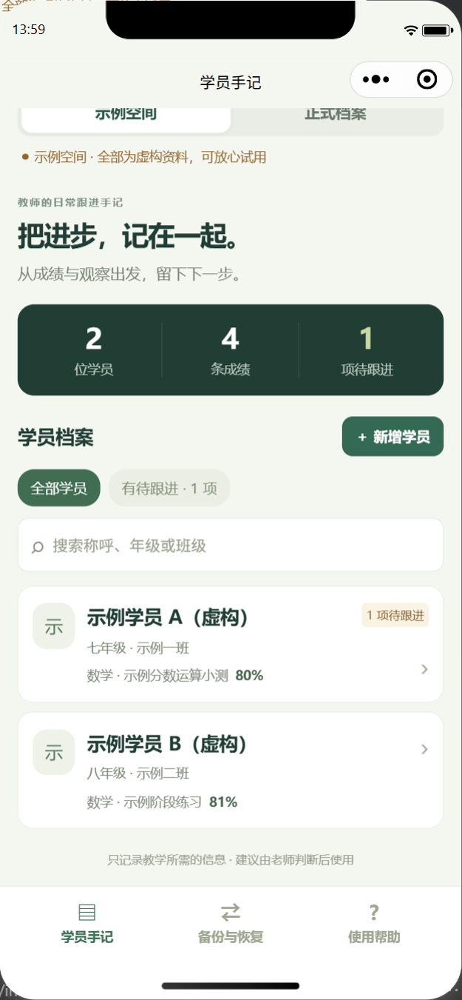
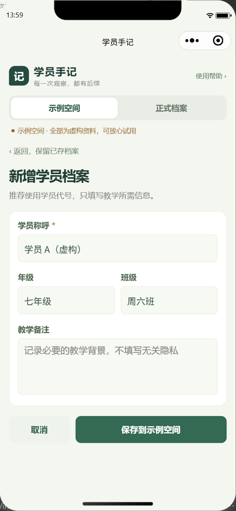
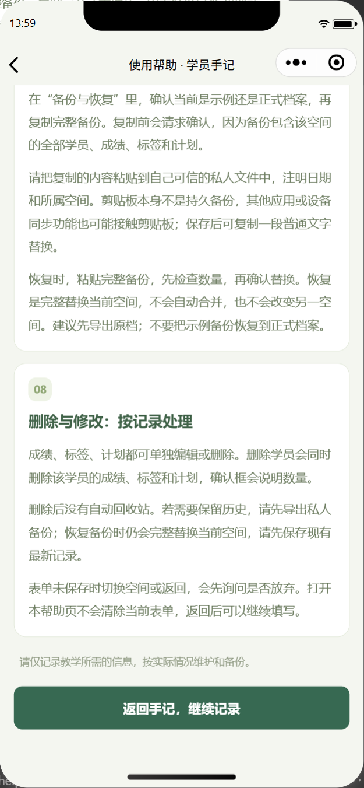
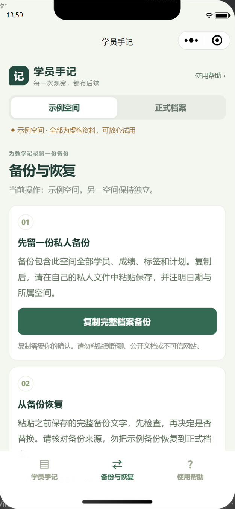

# 微信真实模拟器证据复检

复检日期：2026-10-06。只读检查本轮指定的 `flow-result.json` 与 4 张 PNG；没有操作模拟器、读取用户令牌或接触正式学员数据。本报告使用 Product Design audit 的截图审查方法，范围仅限已提供证据。

**结论：运行结果与截图相互一致，支持本轮已在微信开发者工具真实模拟器完成所列 12 项业务检查。所见画面未发现需要阻断交付的布局或文字问题。** 这不是手机真机验收、完整可访问性合规证明，也不是正式上传、审核或发布回执。

## 运行结果

归档回执：[flow-result.json](wechat-simulator/flow-result.json)。原件：`C:/AgentWorkspace/Wechat-Teacher-Research-20261006/native-automation/evidence/flow-result.json`。记录时间为 `2026-10-06T05:58:19.058Z`，即北京时间 13:58:19。

| 步骤 | 记录中的检查 | 证据结论 |
|---|---|---|
| 1 | 原生首页加载，限定示例空间 | 运行结果记为完成；首页截图显示虚构示例标记 |
| 2 | 帮助页打开并返回 | 运行结果记为完成；帮助底部与返回按钮可见 |
| 3 | 真实输入建立虚构学员并保存 | 运行结果记为完成；新增表单画面布局正常 |
| 4 | 数学成绩录入、保存和图表 | 运行结果记为完成；本次 4 张图不单独证明成绩编辑与图表全过程 |
| 5 | 薄弱知识点标签和依据保存 | 运行结果记为完成；本次没有该步骤截图 |
| 6 | 按数学标签生成有依据的建议 | 运行结果记为完成；本次没有该步骤截图 |
| 7 | 建议由教师确认后保存为计划 | 运行结果记为完成；本次没有该步骤截图 |
| 8 | 记录执行结果并完成计划 | 运行结果记为完成；本次没有该步骤截图 |
| 9 | 重新进入后成绩和计划仍保存 | 运行结果记为完成；支持本轮模拟器重进持久化，不代表换设备或清理缓存后仍保存 |
| 10 | 仅删除本轮虚构验收学员及关联记录 | 运行结果记为完成；`createdTestStudentRemaining` 为 `null` |
| 11 | 待跟进筛选 | 运行结果记为完成；首页截图显示对应筛选入口 |
| 12 | 本轮应用运行时无异常 | `errors` 为空数组 |

结果还记录 `formalDataAccessed: false`。本次复检核对该记录，不将结果摘要冒充独立重放全部自动化步骤。

## 截图复检

以下使用主 Agent 归档到本报告同级 `wechat-simulator/` 后的相对路径；实际查看的原图来自上述 evidence 目录，文件名一致。

### 1. 首页学员卡片：通过

示例与正式入口、虚构资料提示、学员／成绩／待跟进统计、搜索、待跟进筛选及两张示例学员卡片均可辨识。卡片、按钮和底部导航未见重叠；示例姓名明确标记虚构。这是一张已滚动到卡片位置的截图，不是完整初始首屏。

### 2. 新增学员表单：通过

称呼必填标记、年级／班级双列、备注输入区排列清楚，取消与“保存到示例空间”按钮完整可见；保存目标明确。画面未弹出系统软键盘，因此不能据此判断手机键盘遮挡、键盘收起或焦点行为。

### 3. 帮助页底部：通过

备份、完整替换恢复、级联删除、无自动回收站和未保存表单的说明可读，底部返回按钮完整可见。说明没有把剪贴板当作持久备份，也没有承诺其他应用无法接触剪贴板。长文在当前画面无横向溢出；辅助文字较浅，实际手机大字体及可访问性仍需单独验收。

### 4. 备份与恢复：可见部分通过

明确当前操作为示例空间，复制入口说明包含全空间档案并要求确认，私人保存与不要公开的提示可见。恢复卡片只显示上部，无法从本图验证粘贴框、检查结果与最终替换确认是否全部可操作。

## 证据边界

- 本次结果的 12 项检查未列出真实微信剪贴板复制、粘贴以及完整替换恢复操作；截图也不足以证明这条端到端流程完成。此前模拟接口回归不自动转化为真实微信环境证据。
- 手机软键盘、安全区、iOS／Android 真实存储配额和系统剪贴板、字体放大、读屏与真实触控尚不能由这组证据判定通过。
- 本次未检查 preview 文件或扫码结果，不独立确认预览码能在手机打开；生成预览与正式上传／发布是不同状态。
- 这组证据没有正式代码上传、审核通过或公开发布回执；报告不能用于宣称已经上线。

当前所见无必须修复的视觉问题；剩余工作是补齐尚未被这组证据覆盖的真实设备与发布流程验收。
