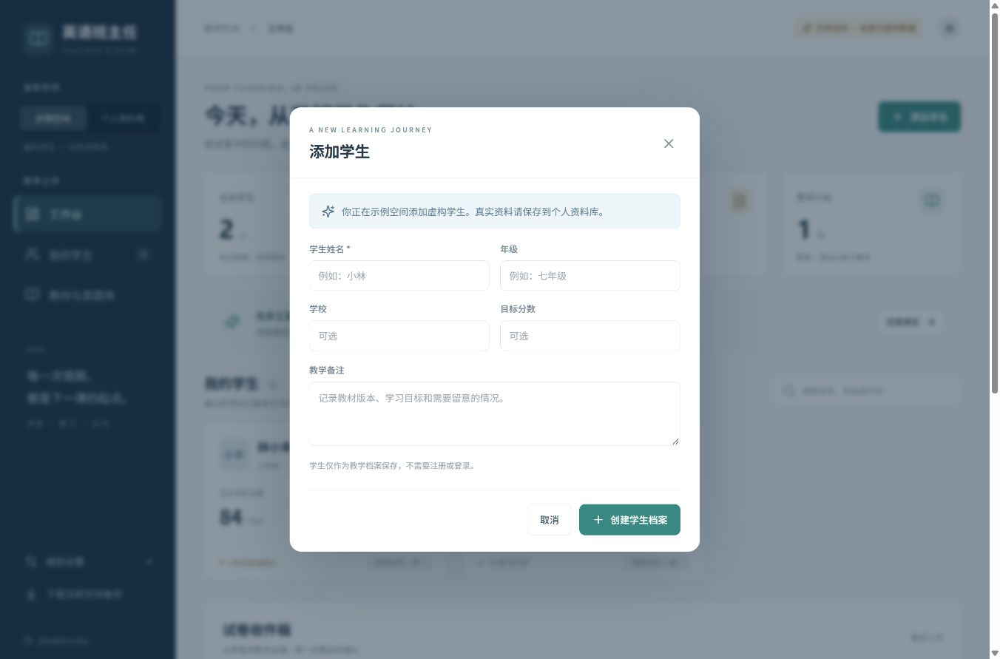
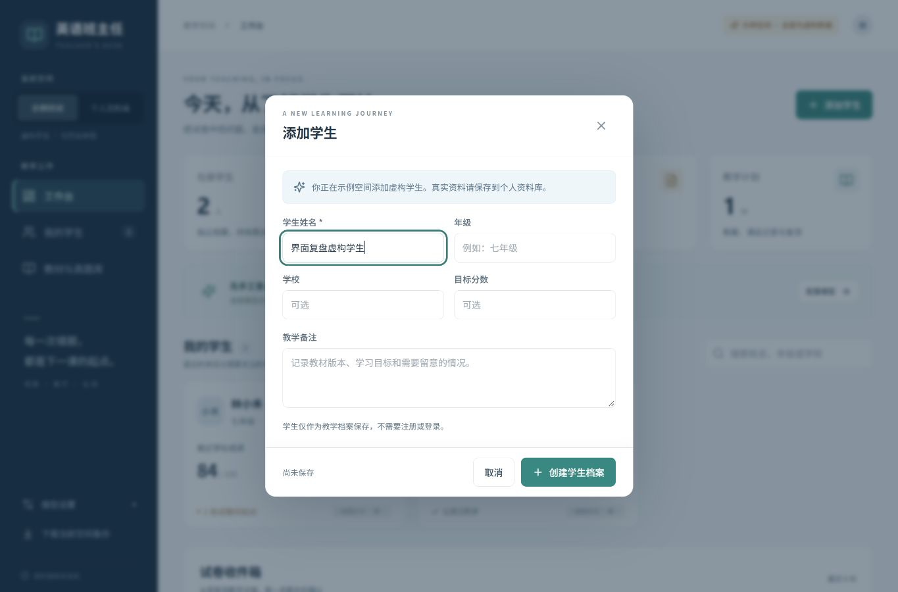
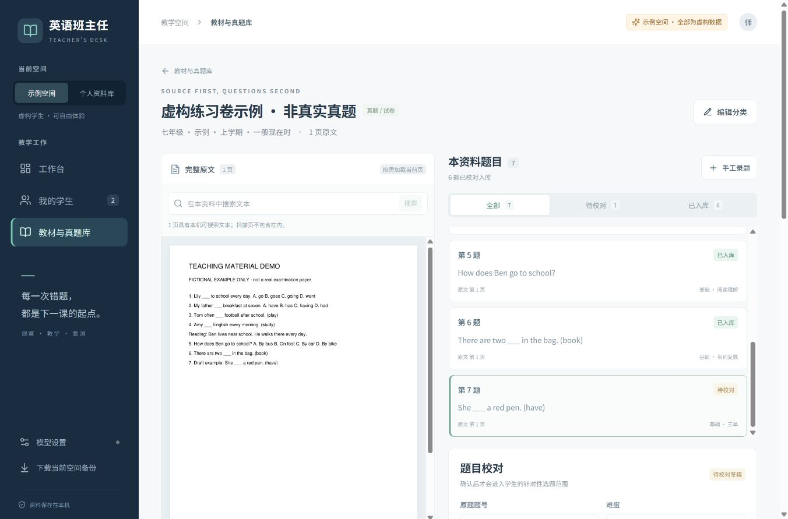
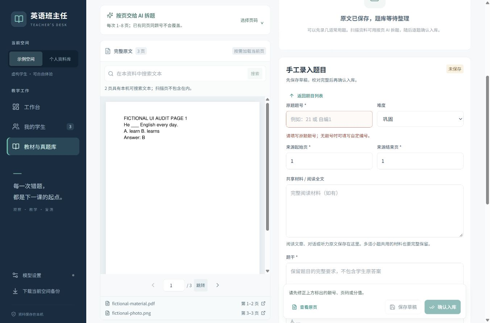
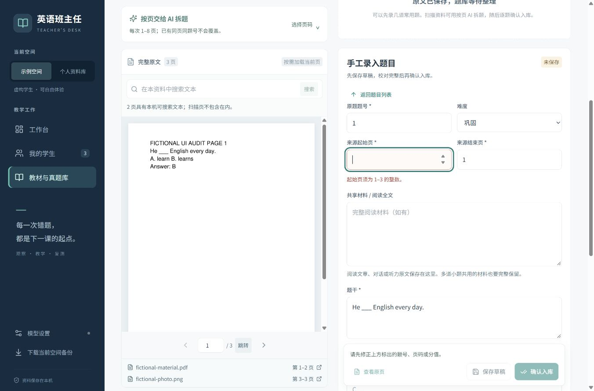
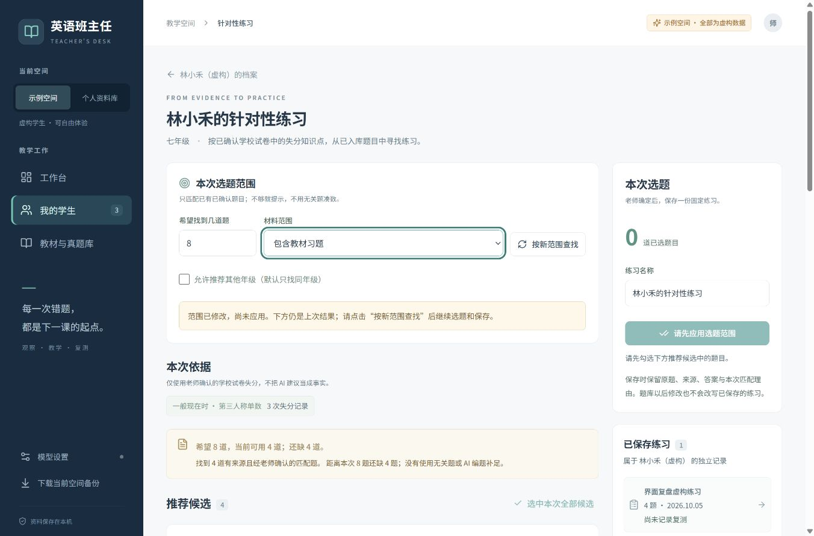
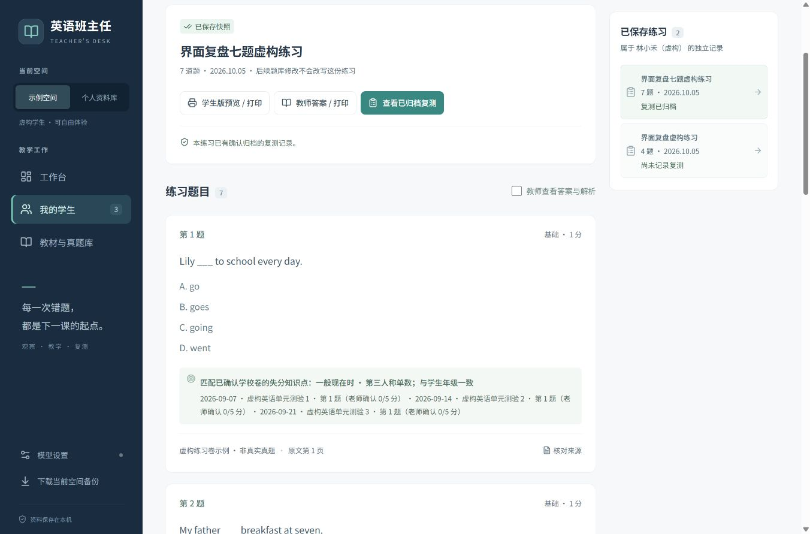
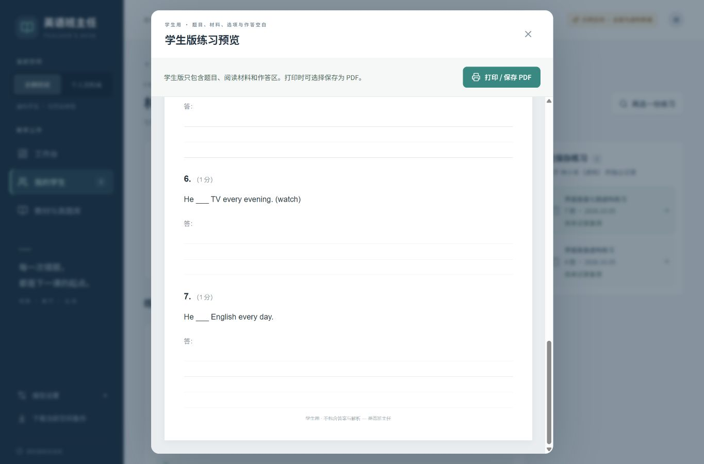
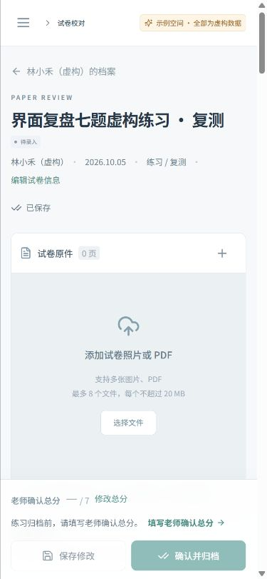
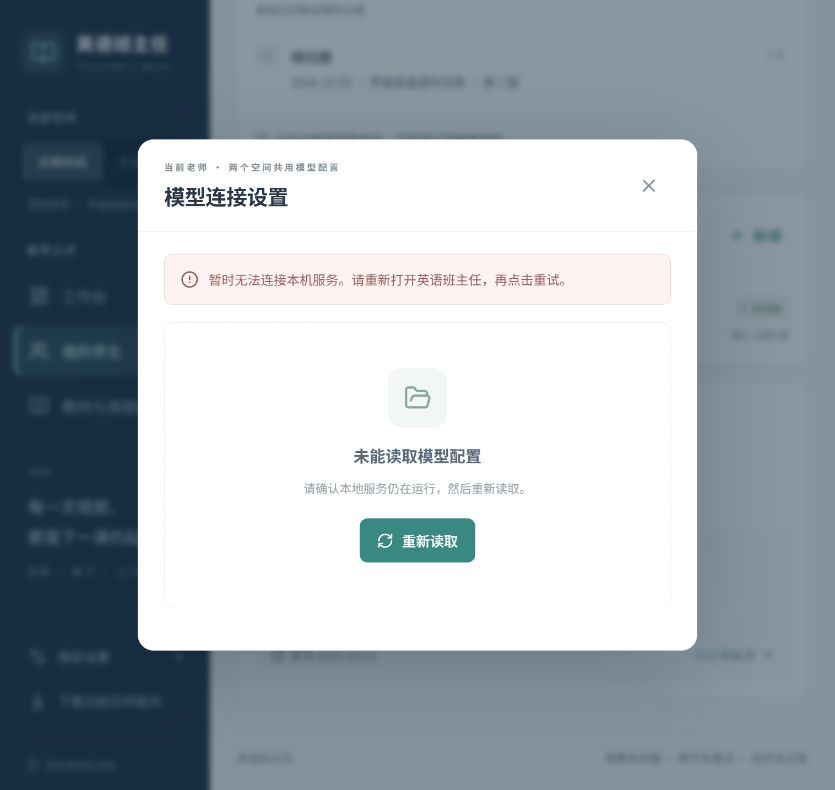

# 界面与按钮复盘 · 2026-10-05

修订：20261005.2。结论：主要教师操作流程已完成修复与浏览器复验。保留原有深蓝、青绿风格，重点修正动作反馈、输入校验、退出保护与排版，不扩展新业务功能。

本轮使用 `127.0.0.1:8773` 与独立 `runtime/ui-audit-20261005`，学生、教材和答案均为虚构验收资料，没有写入正式教学库或调用真实模型。截图在 `验收截图/ui-review-20261005`；before 为修改前，after 为验收时实际页面。

## 按老师工作顺序检查

| 步骤 | 页面与操作 | 复验结果 |
|---|---|---|
| 1 | 工作台、学生列表与档案 | 通过：新增学生后进入正确档案，数量更新；窄屏不横向溢出。 |
| 2 | 新增学生、试卷及通用弹窗 | 通过：首个输入获得焦点，Tab / Shift+Tab 留在弹窗；未保存退出会出现确认。确认框取消分支受自动控制限制，未声称全部验证。 |
| 3 | 试卷逐题校对 | 通过：0 满分不能创建，得分超本题满分就地提示，保存定位错误字段；修改总分展开并聚焦输入。有效学校卷实际完成归档。 |
| 4 | 导入教材 / 真题与分类 | 通过：2 页虚构 PDF + 1 张照片导入成为 3 页资料；分类可编辑保存；没有文件时解释保存按钮不可用的原因。 |
| 5 | 题目编辑与确认入库 | 通过：点击手工录题进入编辑区；非法来源页同时阻止保存和确认；修正后成功入库，保留第 1–2 页来源。 |
| 6 | 针对性选题与保存 | 通过：范围变化提示“尚未应用”，旧候选不可选或保存；重新查找后候选由 4 道变为 7 道，仍显示不足数量；练习保存为固定快照。 |
| 7 | 来源查看、学生 / 教师预览 | 通过：来源可从第 1 页翻到第 2 页；7 题学生预览可滚到最后一题；学生版答案块为 0，教师版为 7。系统打印和实体纸面未实测。 |
| 8 | 复测校对与归档 | 通过：七题全部核对但总分空白时仍禁止归档；填写老师确认总分后归档成功；回练习页按钮改为“查看已归档复测”。 |
| 9 | 手写教案与课后跟进 | 通过：新建显示尚未保存；正文与课后记录提交后只有一份教案；日期通过真实日期选择器设为 2026-10-12 并保存，卡片回读显示该日期。 |
| 10 | 模型设置与断连恢复 | 通过：无密钥时测试按钮解释原因，无修改不重复保存；停止隔离服务后出现中文错误和重新读取按钮，恢复服务后点击重试成功。没有填写或测试真实密钥。 |

## 发现的问题及处理

1. **未保存退出保护不一致。** 旧新增学生填入内容后按 Esc 直接关闭；旧弹窗 Shift+Tab 可进入背景。现统一 ModalFrame，关闭、Esc 和遮罩共用退出判断，忙碌时不可关闭，背景 inert，退出恢复焦点。新增共享栈防止父子弹窗同时卸载后整页被锁住。
2. **按钮可点与实际保存条件不一致。** 旧题库来源页 0 仍能点确认；校卷缺少就地错误引导；复测全题核对但总分空白仍宣称可归档。现按后台合同校验题号、页码、正数满分及得分范围，明确下一步并定位错误。
3. **点了编辑却找不到编辑区。** 旧题目编辑器位于长列表下方。现选中题目或手工录题自动滚动定位；保留返回列表、固定动作条；选页拆题在原文上方可展开。
4. **保存提示与事实不一致。** 旧新教案尚未提交就写“记录已同步”；新建与跟进分两次请求。现一次原子保存，日期无效不残留半成品；保存已成功但随后刷新失败时单独提示，避免引导重复创建。
5. **选择范围变化容易误用旧结果。** 现明确显示范围待应用状态，应用后才可继续选题；已归档复测不再叫“继续记录复测”。
6. **错误、空白和加载混在一起。** 现资料、练习历史、来源图片和设置读取失败有恢复入口；本机断连使用中文说明。真实浏览器故障注入覆盖了设置读取失败与恢复，其他入口经源码复核。
7. **长预览被新弹窗布局裁切。** 独立复核发现后，为练习预览单独补可滚动区域，并在打印样式隐藏弹窗、只保留纸面内容。浏览器确认能滚到第 7 题。
8. **文字、按钮和窄屏布局。** 提高辅助文字可读性、扩大主要点击区；输入与操作按钮不再共用标签；窄屏表单转单栏、底栏换行。390 宽练习页和复测页的 scrollWidth 等于 clientWidth；隐藏导航不再进入键盘顺序。
9. **重新识别的覆盖警告不准确。** 后台确实替换全部题目，现明确告知已保存的人工答案、得分、错因、备注也会替换。此路径只核源码与提示，未调用真实 AI。

## 修改前后证据

表单文字、动作区与焦点：

资料题目编辑定位与来源校验：

选题范围和复测闭环：

长练习、窄屏和恢复：

## 自动与独立复核

- 后台测试：56 passed，37.89 秒；包含 2 个本轮新增的教案原子保存测试。一条 Starlette/httpx 弃用提示，不影响结果。
- 前端 TypeScript 与正式构建通过，最终资源：`index-DdalnR5E.js`、`index-DvuHa2uv.css`。
- 弹窗生命周期最小桩：4 类打开 / 关闭顺序通过；这不是浏览器可访问性认证。
- 独立源码复核发现并促成修复：嵌套弹窗残留锁定、复测总分条件错位、长练习裁切。详见 [独立复核](UI_INDEPENDENT_REVIEW.md)。
- Windows 候选程序：首次启动、坏代理环境下重复打开、个人库初始为空已通过。最终双平台包和正式升级数据一致性另记 `release/ui-review-receipt.json`。
- 桌面最终压缩包：双平台 41 项完整性检查通过；从 Windows 最终包重新解压，首次运行 12 项、关闭重启 3 项、教案完整保存 2 项检查通过，详见 [最终 Windows 包实测](UI_WINDOWS_FINAL.md)。
- 正式升级数据保留：替换程序前后 12 个运行数据文件一致；重启后 22 张表的全部 32 行数据与原库一致，附件和设置一致。原程序、压缩包及运行数据已另存私有回退备份。

## 实测边界

已检查电脑宽屏 1366×900、小窗口 835×790、窄屏 390×844。没有用截图冒充全部可访问性合规，没有测试屏幕阅读器、所有浏览器、真实 Mac、真实 AI 或实体打印。本次原生确认框已实际触发；自动控制工具未可靠暴露取消按钮，因此取消分支未计为浏览器实测通过。未来首次真实教学仍需要一份实际试卷验证识别与教案质量。
